# Таро — рабочее место. Руководство пользователя

Это руководство для повседневной работы с приложением: как запустить, где что находится,
как вести клиентов, расклады, события, итоги и дневник. Приложение локальное: данные
хранятся в SQLite-файле на вашем компьютере и не отправляются в облако.

> Скриншоты в руководстве сделаны на демонстрационных данных. Ваши клиенты, расклады
> и записи выглядят так же, но остаются только у вас.

## Содержание

1. [Запуск, данные и резервные копии](#1-запуск-данные-и-резервные-копии)
2. [Обзор и навигация](#2-обзор-и-навигация)
3. [Карты и свои трактовки](#3-карты-и-свои-трактовки)
4. [Клиенты](#4-клиенты)
5. [Расклады и PDF](#5-расклады-и-pdf)
6. [События](#6-события)
7. [Итоги и история трактовок](#7-итоги-и-история-трактовок)
8. [Дневник и календарь](#8-дневник-и-календарь)
9. [Поиск и статистика](#9-поиск-и-статистика)
10. [Обратная связь: баги и предложения](#10-обратная-связь-баги-и-предложения)
11. [Частые вопросы и решение проблем](#11-частые-вопросы-и-решение-проблем)
12. [Адреса разделов](#адреса-разделов)

---

## 1. Запуск, данные и резервные копии

### Что нужно

- Node.js версии **22.13 или новее** (приложение использует встроенный модуль `node:sqlite`;
  в версиях 22.5–22.12 он ещё требует отдельного флага). Лучше взять Node.js 24 LTS
  или новее. Проверить версию:

  ```bash
  node --version
  ```

- Современный браузер: Safari, Chrome, Firefox или Edge.
- Интернет для работы приложения **не нужен**. Он понадобится только один раз,
  если вы захотите заново скачать изображения карт.

### Запуск

Откройте терминал и выполните:

```bash
cd "Проект по умолчанию/tarot-crm"
node server.js
```

В терминале появится сообщение:

```text
Таро-мастерская запущена: http://localhost:3000
База данных: .../tarot-crm/data/tarot.db
```

Откройте в браузере **http://localhost:3000**.

Остановить приложение — `Ctrl+C` в терминале. Закрывать вкладку браузера можно
в любой момент: данные уже сохранены на диск.

### Другой порт

Если порт 3000 занят:

```bash
PORT=4000 node server.js
```

и открывайте `http://localhost:4000`.

### Режим разработки

Если вы меняете код приложения и хотите, чтобы сервер перезапускался сам:

```bash
node --watch server.js
```

### Где лежат данные

Все записи находятся в одном файле:

```text
tarot-crm/data/tarot.db
```

Рядом могут появляться служебные файлы `tarot.db-wal` и `tarot.db-shm` — это часть
SQLite. База и эти файлы **не попадают в Git**, поэтому личные записи не публикуются
вместе с кодом.

### Резервная копия

Самый простой способ — кнопка **«Резервная копия»** в боковом меню, под именем
разработчика. Нажмите её один раз: приложение сделает целостный снимок базы,
не останавливая сервер, и положит его в папку `data/backups/`. Имя файла содержит
дату и время, например `tarot-20261030-132042.db`. Рядом с кнопкой видно, когда
сделана последняя копия, а полный путь и размер — во всплывающей подсказке.

Старые копии не удаляются автоматически. Их можно хранить в `data/backups/`
или периодически переносить в другое место.

Если хотите сделать копию вручную:

1. Остановите сервер (`Ctrl+C`).
2. Скопируйте файл `data/tarot.db` в надёжное место.
3. Если рядом есть `tarot.db-wal` и `tarot.db-shm`, скопируйте и их — так база
   восстановится точно в том состоянии, в котором была.

Можно сделать копию и через SQLite, не останавливая сервер:

```bash
cd "Проект по умолчанию/tarot-crm"
sqlite3 data/tarot.db ".backup 'data/backup-2026-10-29.db'"
```

Такой файл — уже готовая копия базы, без WAL.

### Восстановление и перенос

1. Остановите сервер.
2. Замените `data/tarot.db` (и при наличии `-wal`/`-shm`) своей копией.
3. Запустите `node server.js` снова.

Чтобы перенести приложение на другой компьютер, скопируйте всю папку `tarot-crm`
вместе с `data/tarot.db`. Установите Node.js и запустите сервер там.

### Обновление приложения

Перед обновлением всегда делайте резервную копию базы. При запуске новой версии
схема базы обновляется автоматически; существующие записи сохраняются.

---

## 2. Обзор и навигация

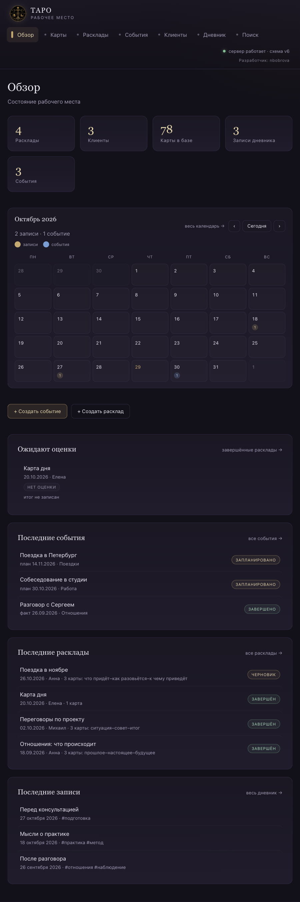

«Обзор» — стартовая страница. Сверху видно, сколько в базе раскладов, клиентов, карт,
записей дневника и событий.

Дальше идут:

- **Карта дня** — карта-настройка на сегодня. Нажмите «Вытянуть карту дня»: приложение
  случайно выберет карту и положение. До конца дня показывается одна и та же карта.
  Можно открыть её в базе знаний или сразу создать запись в дневнике — карта и дата
  подставятся в форму.
- **Календарь месяца** — записи и события по дням. Кнопки `‹` и `›` листают месяцы,
  «Сегодня» возвращает к текущему месяцу. Клик по дню открывает дневник на этой дате.
  В клетке дня видны золотые метки записей и синие метки событий. Кнопка «+» в дне
  позволяет сразу создать запись или событие.
- **Быстрые действия** — «Создать событие» и «Создать расклад».
- **Ожидают оценки** — завершённые расклады без итога, а также расклады, к которым
  пора вернуться. Это главный список «что не забыть».
- **Последние события** — пять последних событий со статусами.
- **Последние расклады** — недавние расклады со статусами и клиентами.
- **Последние записи** — свежие записи дневника с тегами.

### Меню

Слева (на широком экране) или сверху (на узком) находятся разделы:

- **Обзор** — текущая работа.
- **Карты** — база знаний по 78 картам.
- **Расклады** — история консультаций.
- **События** — что запланировано и чем закончилось.
- **Клиенты** — карточки и история обращений.
- **Дневник** — записи и календарь.
- **Поиск** — поиск по всей мастерской и статистика.

В правом верхнем углу — индикатор «сервер работает» и версия схемы базы. Если индикатор
красный или страница не загружается, проверьте, запущен ли `node server.js`.

### Как устроен интерфейс

- Тёмная тема, крупные заголовки и золотые акценты.
- Выпадающие списки — собственные, а не системные. В длинных списках (например,
  при выборе карты) появляется поле поиска.
- В фильтрах есть кнопка **«Сбросить фильтры»**. Она появляется, только когда выбран
  хотя бы один фильтр.
- Поля, обязательные для заполнения, помечены звёздочкой рядом с названием: `Дата*`.
- На узком экране меню переносится наверх, а блоки выстраиваются в одну колонку.

---

## 3. Карты и свои трактовки

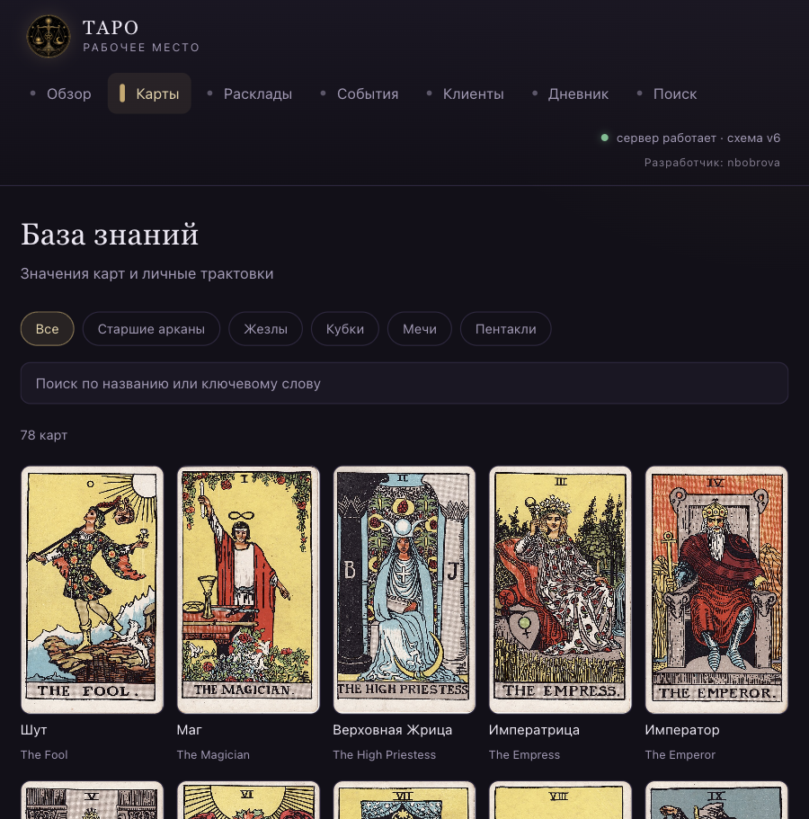

Раздел «Карты» — это справочник всех 78 карт Rider–Waite–Smith: 22 старших аркана
и 56 младших (Жезлы, Кубки, Мечи, Пентакли).

### Поиск и фильтры

- Кнопки сверху: «Все», «Старшие арканы», «Жезлы», «Кубки», «Мечи», «Пентакли».
- Поле поиска ищет по русскому и английскому названию, ключевым словам и темам.
- Счётчик под фильтрами показывает, сколько карт найдено.

### Карточка карты

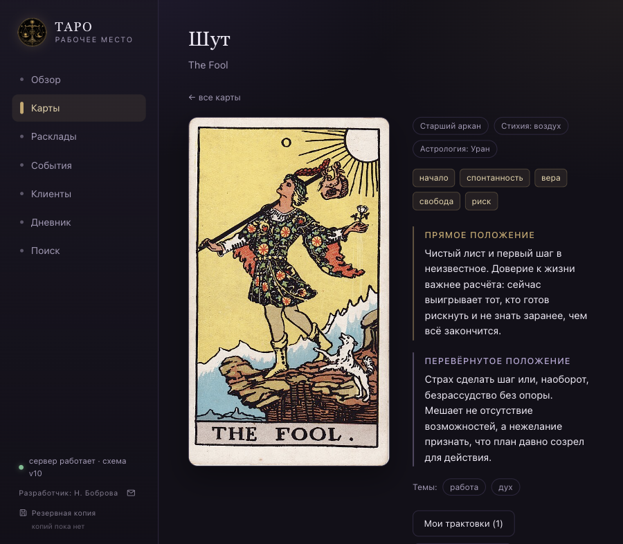

На странице карты есть:

- изображение и название на русском и английском;
- аркан, стихия и астрологическое соответствие;
- ключевые слова;
- значение в прямом и перевёрнутом положении;
- темы: любовь, работа, деньги, здоровье, дух и другие.

Ключевые слова и темы кликабельны: нажмите на них, чтобы открыть подборку карт
с этим словом.

### Свои трактовки

Кнопка **«Добавить свою трактовку»** открывает форму:

- **Положение** — прямое или перевёрнутое.
- **Заголовок** — необязательно.
- **Трактовка** — до 1000 символов.

Своя трактовка появляется в блоке «Мои трактовки» и может быть выбрана при добавлении
карты в расклад. Исходный текст справочника при этом не меняется. Свою трактовку можно
изменить или удалить.

Личные заметки карты сохраняются отдельно и не заменяют стандартное значение.

### Запись в дневник

Кнопка **«Запись в дневник»** создаёт запись, уже связанную с этой картой. Останется
дописать текст и сохранить.

---

## 4. Клиенты

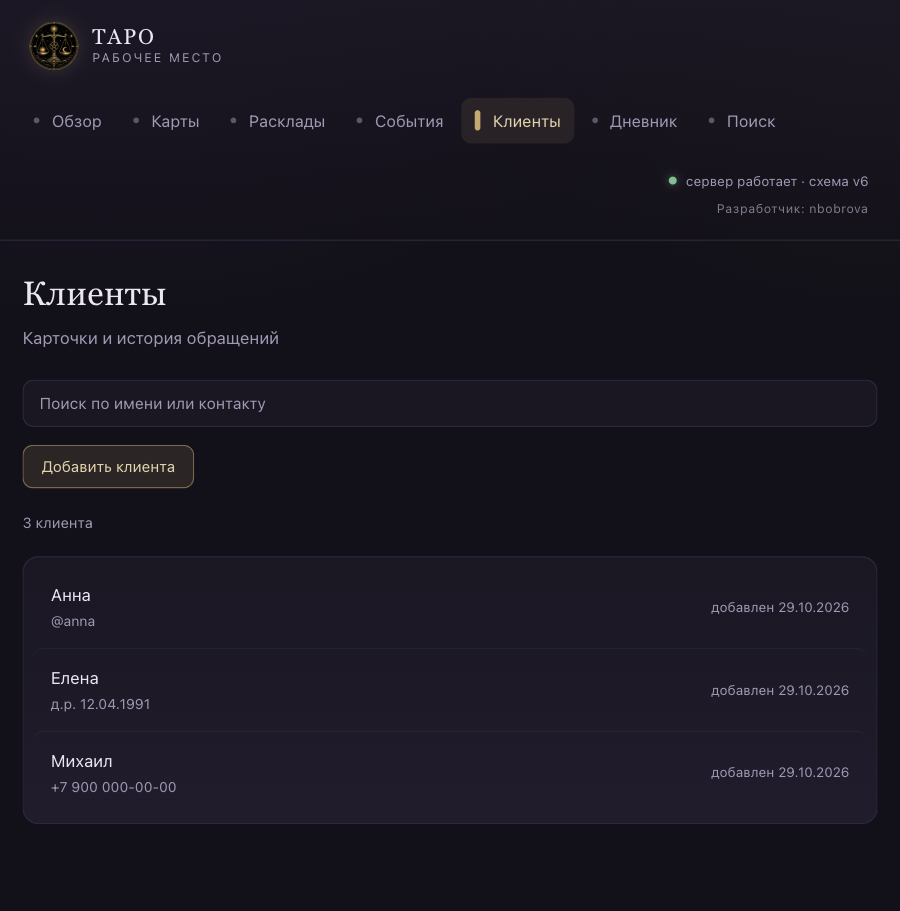

Раздел «Клиенты» хранит карточки людей и историю обращений.

### Список клиентов

- Поиск по имени или контакту.
- Кнопка «Добавить клиента».
- В строке видны имя, контакт или дата рождения.

### Создание и редактирование

В карточке клиента заполняются:

- **Имя** — обязательное поле.
- **Контакт** — телефон, мессенджер, почта.
- **Дата рождения** — необязательно.
- **Заметки** — свободный текст.

### Карточка клиента

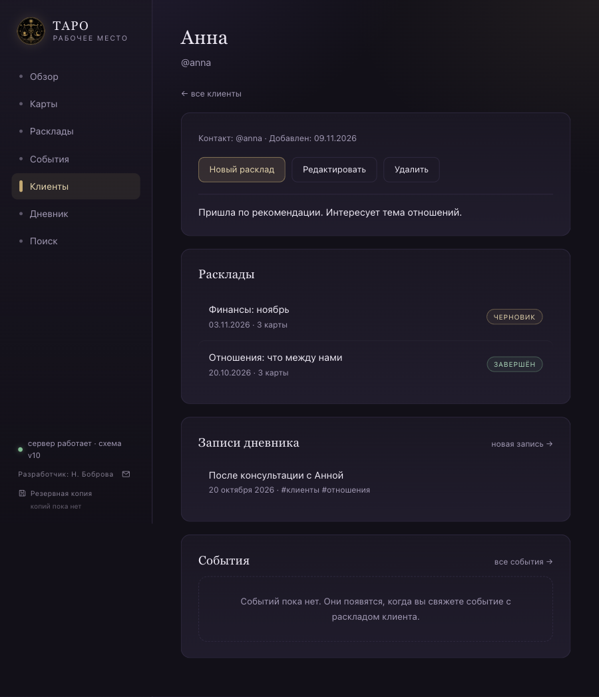

На странице клиента собрано всё связанное:

- контакт, дата рождения и заметки;
- **Расклады** — с датами, типами и статусами;
- **Записи дневника** — с тегами;
- **События** — события, связанные с раскладами клиента.

Кнопка «Новый расклад» создаёт расклад с уже выбранным клиентом.

### Удаление

При удалении клиента приложение попросит подтверждение. Расклады и записи дневника
**не удаляются**: они остаются в базе, но без привязки к клиенту. События также
сохраняются.

---

## 5. Расклады и PDF

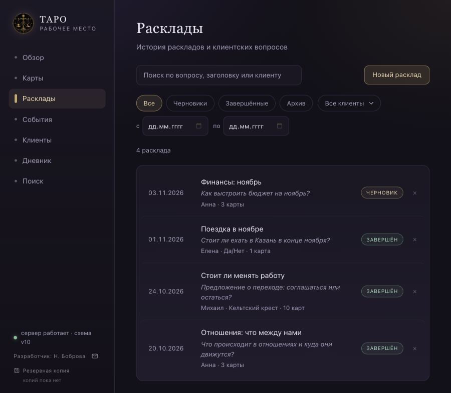

Раздел «Расклады» — основная история консультаций.

### Список и фильтры

- Поиск по вопросу, заголовку, клиенту, трактовке, выводам и итогу.
- Фильтры по статусу: «Все», «Черновики», «Завершённые», «Архив».
- Фильтр по клиенту.
- Период «с» и «по».
- Кнопка «Сбросить фильтры».
- В строке расклада видны дата, заголовок, вопрос, клиент, тип расклада и статус.
- Расклад можно удалить прямо из списка, не открывая его.

### Новый расклад

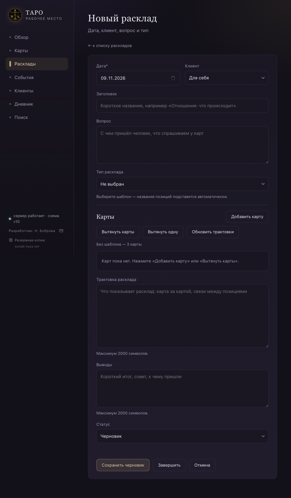

1. **Дата\*** — подставляется сегодняшняя, можно изменить.
2. **Клиент** — выберите из списка или оставьте «Для себя».
3. **Заголовок** — короткое название, например «Отношения: что происходит».
4. **Вопрос** — с чем пришёл человек.
5. **Тип расклада** — «1 карта», «Да/Нет», один из триплетов или «Кельтский крест».
   Позиции подставляются автоматически.

Доступные триплеты:

- прошлое–настоящее–будущее;
- что придёт–как разовьётся–к чему приведёт;
- ситуация–препятствие–совет;
- причина–развитие–итог.

«Да/Нет» — расклад на вопрос, на который можно ответить «да» или «нет».
Вытягивается одна карта; приложение не делает автоматический вывод, ответ
читается по карте.

### Карты

- **«Вытянуть карты»** заполняет все позиции случайными картами.
- **«Вытянуть одну»** добавляет одну случайную карту.
- **«Добавить карту»** открывает выбор вручную: поиск по названию или ключевому слову.
- У каждой карты можно переключить положение «прямая / перевёрнутая».
- Для каждой позиции можно выбрать свою трактовку, если она добавлена в базе знаний.
- В заметке к карте можно записать наблюдение по конкретной позиции.

Если все позиции заняты, приложение предложит заменить карты новыми.

### Трактовка и выводы

- **Трактовка расклада** — до 2000 символов.
- **Выводы** — до 2000 символов.
- **Статус**: черновик, завершён, архив.

Черновик удобно использовать во время сессии, а «Завершён» — когда расклад
сформулирован и готов к обратной связи.

### Страница расклада

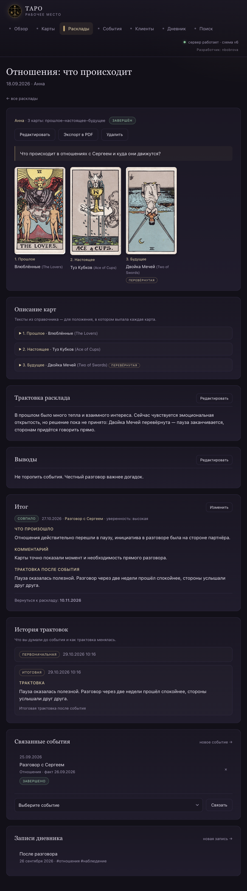

На странице расклада видны:

- клиент, дата, тип и статус;
- карты с позициями и положениями;
- раскрывающиеся описания карт из справочника;
- трактовка и выводы;
- блок **«Итог»**;
- **«История трактовок»**;
- связанные события;
- записи дневника.

Кнопки:

- **«Редактировать»** — изменить расклад и карты.
- **«Экспорт в PDF»** — открыть предпросмотр для печати.
- **«Экспорт в JSON»** — скачать расклад одним файлом: карты, трактовки, итоги,
  оценки позиций, историю трактовок и связанные события.
- **«Удалить»** — удалить расклад после подтверждения.

### PDF

Нажмите «Экспорт в PDF». Откроется предпросмотр в стиле приложения. В диалоге печати
выберите **«Сохранить как PDF»**. Если окно не открылось, разрешите всплывающие окна
для `localhost` и попробуйте снова.

---

## 6. События

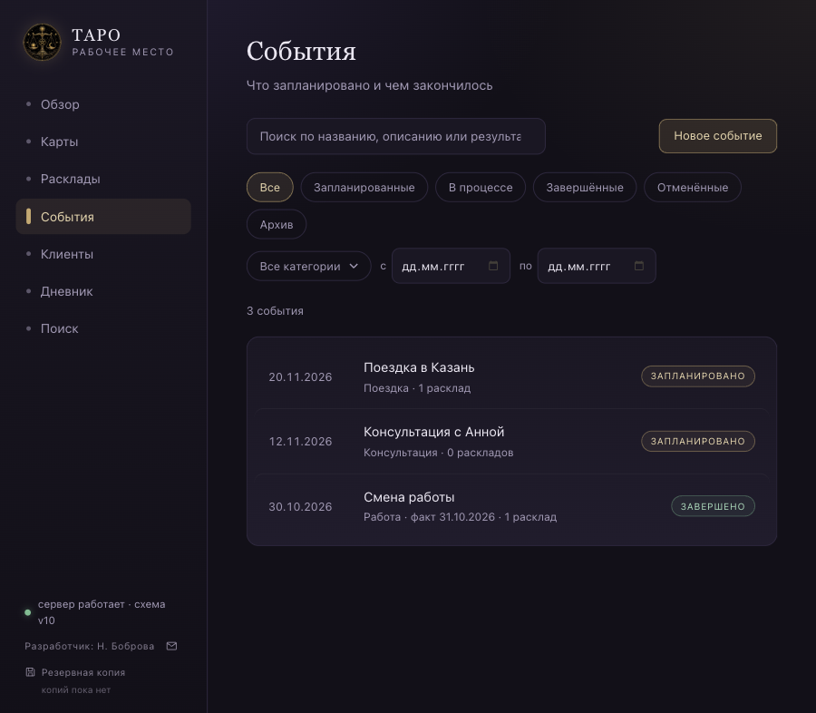

События связывают вопрос и реальность: что было запланировано и чем закончилось.

### Список и фильтры

- Поиск по названию, описанию, результату и заметкам.
- Фильтры по статусу: «Все», «Запланированные», «В процессе», «Завершённые»,
  «Отменённые», «Архив».
- Фильтр по категории.
- Период «с» и «по».
- Кнопка «Сбросить фильтры».

### Новое событие

- **Название\*** — обязательное поле.
- **Категория** — свободный текст: «Работа», «Отношения», «Поездки».
- **Статус** — запланировано, в процессе, завершено, отменено, архив.
- **Планируемая дата** и **фактическая дата**.
- **Описание** — что должно произойти.
- **Фактический результат** — что произошло на самом деле.
- **Заметки** — до 5000 символов.

Событие можно создать из календаря — тогда дата подставится автоматически.

### Страница события

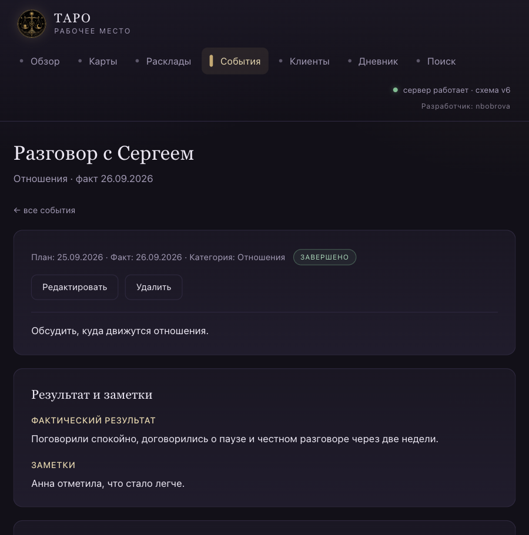

На странице события видны:

- статус, планируемая и фактическая даты, категория;
- описание;
- фактический результат и заметки;
- **связанные расклады** и сводка их оценок;
- кнопка «Создать расклад» — новый расклад сразу связан с событием.

Связать событие с существующим раскладом можно из карточки события, а расклад
с событием — из карточки расклада. Связь работает в обе стороны.

### Удаление

При удалении события связи с раскладами удаляются, но **сами расклады остаются**.
Приложение попросит подтверждение.

### Статусы

- **Запланировано** — событие впереди.
- **В процессе** — уже началось, результат ещё не ясен.
- **Завершено** — есть фактический результат.
- **Отменено** — не состоялось.
- **Архив** — убрано из активной работы.

В календаре отменённые и архивные события по умолчанию скрыты.

---

## 7. Итоги и история трактовок

Блок «Итог» находится на странице расклада. Он нужен, чтобы проверить трактовку
реальностью и накопить обратную связь.

### Как записать итог

1. Откройте завершённый расклад.
2. В блоке «Итог» нажмите «Изменить» или «Добавить».
3. Заполните поля:
   - **Что произошло** — фактический результат;
   - **Оценка** — совпало, частично, не совпало, недостаточно информации,
     пока нельзя оценить;
   - **Комментарий** — почему вы так считаете;
   - **Уверенность** — низкая, средняя, высокая;
   - **Вернуться к раскладу** — дата повторной проверки;
   - **Трактовка после события** — как вы теперь понимаете расклад.
4. Сохраните.

Каждое сохранение добавляет **новую запись** в историю. Старые оценки не перезаписываются:
видно, как менялось понимание со временем. Текущей считается последняя оценка
по дате и номеру записи.

### Оценки

- **Совпало** — событие и трактовка совпали по сути.
- **Частично** — направление верное, детали разошлись.
- **Не совпало** — результат противоречит трактовке.
- **Недостаточно информации** — событие ещё не проявилось или данных мало.
- **Пока нельзя оценить** — рано, нужно вернуться позже.

### Оценки позиций

Блок «Оценки позиций» на странице расклада позволяет проверить каждую карту отдельно.
Это удобно, когда общий итог понятен, а одна-две позиции сработали иначе.

1. В строке нужной позиции нажмите «Оценить».
2. Заполните те же поля, что и для общего итога: что произошло, оценка, комментарий,
   уверенность, дата оценки и дата возврата.
3. Сохраните.

У каждой позиции своя история: кнопка «Изменить» добавляет новую запись, а предыдущие
остаются в раскрывающемся списке. Оценки позиций не меняют общий итог и не влияют
на статистику раскладов.

### История трактовок

В блоке «История трактовок» сохраняются:

- **первоначальная** трактовка и выводы — снимок на момент завершения расклада;
- **обновления** — правки после завершения;
- **итоговая** трактовка — после события.

Первоначальный снимок не перезаписывается. Это позволяет честно сравнивать
первый взгляд и выводы после результата.

### «Ожидают оценки»

На «Обзоре» в этот блок попадают:

- завершённые расклады, у которых ещё нет ни одной оценки;
- расклады с оценкой «пока нельзя оценить» или «недостаточно информации»,
  если дата возврата уже наступила.

Нажмите на строку, чтобы открыть расклад и записать итог.

### Сводка на событии

На странице события видно, сколько связанных раскладов уже оценено и как распределились
оценки. Это помогает понять, насколько точными были трактовки по конкретному событию.

---

## 8. Дневник и календарь

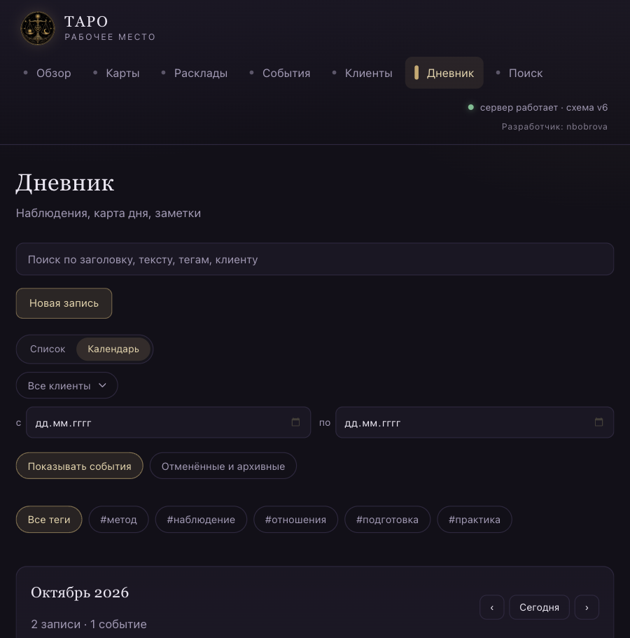

Дневник — это наблюдения, «карта дня», заметки о практике и быстрые записи.

### Два вида

- **Список** — записи и события по датам.
- **Календарь** — записи и события в одной сетке по месяцам.

Переключатель «Список / Календарь» находится под кнопкой «Новая запись».

### Запись дневника

- **Дата\*** — по умолчанию сегодня.
- **Заголовок**.
- **Текст** — до 3000 символов.
- **Теги** — до 20 штук, каждый до 40 символов.
- **Клиент**, **расклад**, **карта** — необязательные привязки.

Запись можно создать из карточки карты, клиента или расклада — привязка подставится.

### Фильтры

- Поиск по заголовку, тексту, тегам и клиенту.
- Фильтр по клиенту.
- Период «с» и «по».
- Теги — нажмите на тег, чтобы оставить только записи с ним.
- Кнопка «Сбросить фильтры».

В списке рядом с записями видны события: у них бейдж «Событие», статус и ссылка
на карточку события. Переключатель «Показывать события» скрывает их, если нужны
только записи; «Отменённые и архивные» показывает события, скрытые по умолчанию.

### Календарь

- В клетке дня видны золотые метки записей и синие метки событий.
- В выбранном дне — два отдельных списка: записи и события.
- Кнопка **«+»** в клетке дня открывает меню: «Запись в дневнике» или «Событие».
  Дата подставляется в форму, а после сохранения приложение возвращает в календарь
  на этот день.
- Переключатель **«Показывать события»** убирает события из сетки, оставляя записи.
- Переключатель **«Отменённые и архивные»** показывает события, скрытые по умолчанию.
- Событие показывается по фактической дате, если она заполнена, иначе по планируемой.
  События без дат в календарь не попадают.

Месяц, выбранный день, вид и фильтры сохраняются в адресе страницы. Ссылку можно
обновить или вернуться назад без потери вида.

### Календарь на «Обзоре»

Компактный календарь на главной работает так же: листает месяцы, показывает метки
и открывает дневник на выбранном дне. Кнопка «+» позволяет создать запись или событие,
не уходя с обзора.

---

## 9. Поиск и статистика

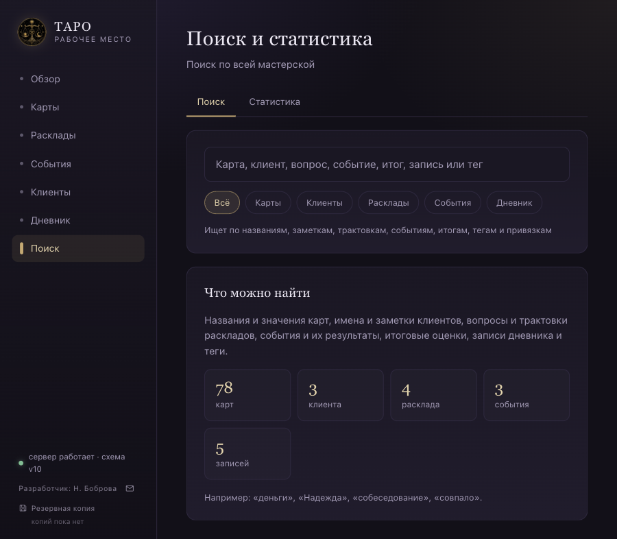

### Поиск

Поле поиска ищет сразу по всей мастерской:

- **Карты** — названия, значения, ключевые слова, темы.
- **Клиенты** — имена, контакты, заметки.
- **Расклады** — заголовки, вопросы, трактовки, выводы, итоговые результаты и оценки.
- **События** — названия, описания, категории, результаты, заметки.
- **Дневник** — заголовки, текст, теги.

Область поиска можно сузить кнопками «Карты», «Клиенты», «Расклады», «События»,
«Дневник» или оставить «Всё». Кнопка «Сбросить фильтры» очищает запрос и область.

Примеры запросов: «деньги», «Надежда», «собеседование», «совпало».

### Статистика

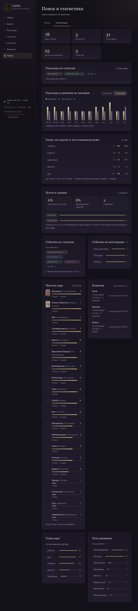

Вкладка «Статистика» показывает:

- **Счётчики** — карты, клиенты, расклады, записи, события.
- **Расклады по статусам** — черновики, завершённые, архив; отдельно — расклады для себя.
- **Итоги и оценки** — доля раскладов с итогом, доля завершённых с оценкой,
  размер выборки и распределение оценок.
- **События по статусам** — запланированные, в процессе, завершённые, отменённые, архив;
  сколько событий имеют фактический результат.
- **События по категориям** — распределение событий по свободным категориям.
- **Частота карт** — какие карты выпадали чаще, с прямыми и перевёрнутыми положениями.
- **Клиенты** — активность: расклады, карты, записи, последний расклад.
- **Темы карт** — какие темы приходят чаще.
- **Теги дневника** — сколько записей с каждым тегом.

Распределение оценок считается по **последней** оценке каждого расклада. Размер выборки —
число раскладов, у которых есть хотя бы одна оценка. Поэтому проценты не путаются
с общим числом раскладов.

Статистика помогает заметить закономерности: какие карты повторяются, какие темы
приходят к клиентам, как часто трактовки совпадают с реальностью.

---

## 10. Обратная связь: баги и предложения

Если в приложении что-то работает не так, встретилась неточность в тексте или
появилась идея для доработки, напишите об этом прямо из приложения.

1. В боковом меню, рядом с надписью «Разработчик: nbobrova», нажмите иконку почты.
2. Выберите тему: «Баг», «Неточность», «Предложение» или «Другое».
3. Опишите, что случилось или что хочется улучшить. Чем конкретнее — тем полезнее:
   на какой странице вы были, что нажали и что ожидали увидеть.
4. Нажмите «Отправить». Появится подтверждение «Сообщение сохранено».

Сообщение сохраняется в базе `data/tarot.db`. Вместе с текстом записываются адрес
страницы, её заголовок и браузер — это помогает быстрее воспроизвести ситуацию.
Письмо на почту пока не отправляется: сообщения копятся локально, чтобы потом
разобрать их вручную.

Посмотреть сохранённые сообщения можно по ссылке «Сохранённые сообщения →»
в окне отправки или по адресу `http://localhost:3000/#/feedback`. Новые сообщения
показываются сверху, у каждого видна тема, дата, страница и текст.

Если сообщение не отправляется, проверьте, что сервер запущен и в поле есть текст.
Сама отправка ничего не удаляет и не меняет в раскладах, клиентах и дневнике.

---

## 11. Частые вопросы и решение проблем

### Сервер не запускается: «EADDRINUSE»

Порт 3000 уже занят. Либо остановите старый процесс:

```bash
lsof -ti tcp:3000 | xargs kill
```

либо запустите на другом порту:

```bash
PORT=4000 node server.js
```

### Ошибка про `node:sqlite`

Слишком старая версия Node.js. Установите Node.js 22.13 или новее и проверьте:

```bash
node --version
```

### Пропали изображения карт

Скачайте их заново (нужен интернет):

```bash
cd "Проект по умолчанию/tarot-crm"
node scripts/fetch-images.js
```

Если интернета нет, вместо изображений показывается заглушка, но тексты карт
и все записи работают.

### Не открывается PDF

Разрешите всплывающие окна для `localhost` в настройках браузера. Затем снова нажмите
«Экспорт в PDF» и выберите «Сохранить как PDF» в диалоге печати.

### Страница выглядит устаревшей

Обновите вкладку с очисткой кеша: `Cmd+Shift+R` в Safari/Chrome на macOS
или `Ctrl+Shift+R` в Windows/Linux.

### Я случайно удалил запись

Встроенной корзины нет: удаление необратимо. Восстановить данные можно только
из резервной копии базы. Поэтому делайте копию `data/tarot.db` перед большими
изменениями и периодически.

### Можно ли работать с телефона или из другого города?

Сейчас сервер слушает только `127.0.0.1`, то есть приложение доступно только
на этом компьютере. Для доступа по сети нужна отдельная настройка сервера
и защита доступа; по умолчанию этого нет.

### Куда отправляются данные?

Никуда. База лежит в `data/tarot.db`, сервер работает локально. В интернет уходит
только запрос за изображениями карт, если вы вручную запускаете `scripts/fetch-images.js`.

### Можно ли вести несколько практик или пользователей?

Приложение рассчитано на одного практика на одном компьютере. Для разделения
используйте клиентов, категории событий и теги дневника.

### Как сделать бэкап перед обновлением?

Остановите сервер и скопируйте `data/tarot.db` (и файлы `-wal`/`-shm`, если они есть)
в отдельную папку с датой. После обновления запустите сервер и проверьте, что
клиенты и расклады на месте.

---

## Адреса разделов

Если нужно открыть раздел напрямую, добавьте к `http://localhost:3000` один из адресов:

| Раздел | Адрес |
|---|---|
| Обзор | `/#/` |
| Карты | `/#/cards` |
| Расклады | `/#/readings` |
| Новый расклад | `/#/readings/new` |
| События | `/#/events` |
| Новое событие | `/#/events/new` |
| Клиенты | `/#/clients` |
| Дневник, список | `/#/journal` |
| Дневник, календарь | `/#/journal?view=calendar` |
| Поиск | `/#/search` |
| Статистика | `/#/search?tab=stats` |
| Сообщения разработчику | `/#/feedback` |

Например: `http://localhost:3000/#/journal?view=calendar&month=2026-10`.

---

## Коротко о главном

1. Запустите `node server.js` и откройте `http://localhost:3000`.
2. Создайте клиента или расклад.
3. Запишите вопрос, карты, трактовку и выводы.
4. Свяжите расклад с событием.
5. После события запишите итог и оценку.
6. Вернитесь к раскладу в дату возврата и обновите трактовку.
7. Смотрите статистику, чтобы понимать свою практику.
8. Делайте резервные копии `data/tarot.db`.

Удачной практики.
